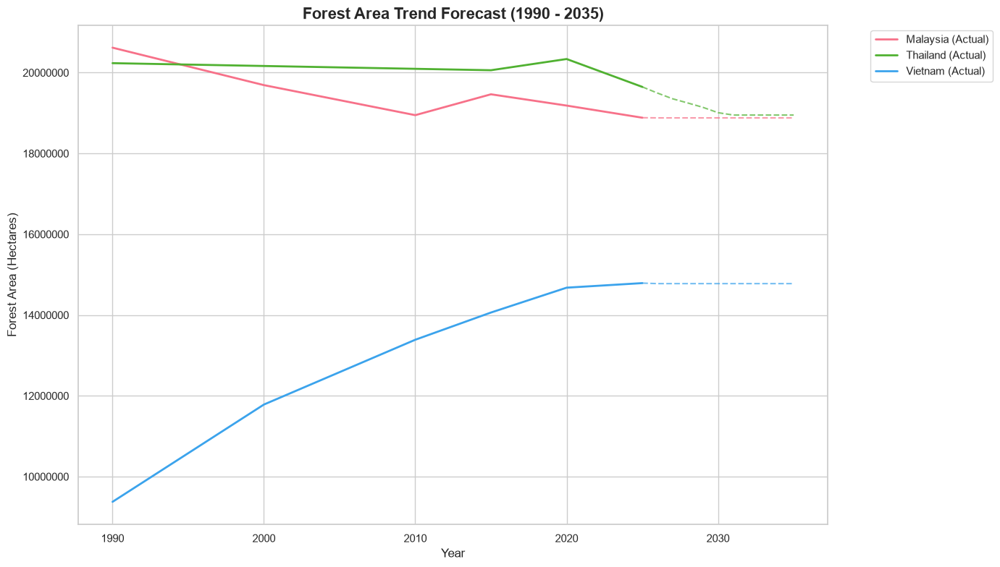
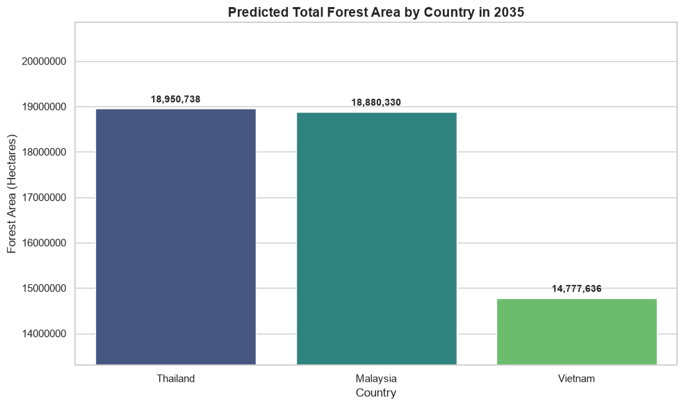

# Forest Area Forecasting with XGBoost (Malaysia, Thailand, Vietnam)

This project uses an **XGBoost regression model** to study forest area in three Southeast Asian countries from **1990 to 2025** and to **forecast forest area up to 2035**.

The notebook:
1. Summarises forest area statistics for each country.
2. Measures how much forest each country gained or lost between 1990 and 2025.
3. Trains an XGBoost model using the previous year's forest area as the main feature.
4. Measures how accurate the model is (MAE, RMSE, R², Accuracy %).
5. Forecasts forest area for 2026–2035 and saves the results to CSV.
6. Draws a trend line chart and a 2035 bar chart.

---

## Project files

| File | Type | Description |
|---|---|---|
| `forest-area-3.xlsx` | **Input** | Forest area data for Malaysia, Thailand and Vietnam, 1990–2025 (108 rows). Columns: `Entity`, `Code`, `Year`, `Forest area` (hectares). |
| `XGboot_forestArea.ipynb` | **Code** | The Jupyter notebook that does the analysis, training and forecasting. |
| `country_accuracy_with_total_area.csv` | **Output** | Model accuracy for each country. Created by Cell 4. |
| `forest_forecast_hectares_2035.csv` | **Output** | Actual data (1990–2025) and forecasts (2026–2035). Created by Cell 5. |
| `images/` | **Output** | Saved copies of the two charts used in this README. |

```
forest-area-3.xlsx ──► XGboot_forestArea.ipynb ──► country_accuracy_with_total_area.csv
     (input)              (analysis + model)        forest_forecast_hectares_2035.csv
```

The two CSV files are **created again every time the notebook runs**, so they can be safely deleted. Only `forest-area-3.xlsx` and `XGboot_forestArea.ipynb` are required.

---

## Requirements

- **Python 3.10 or newer** (tested on Python 3.15)
- **Jupyter**, either VS Code with the Jupyter extension, JupyterLab, or Google Colab

### Libraries

| Library | Used for |
|---|---|
| `pandas` | Loading and organising the data |
| `numpy` | Calculations |
| `openpyxl` | Lets pandas read the `.xlsx` file |
| `xgboost` | The XGBoost regression model |
| `scikit-learn` | `LabelEncoder`, `MinMaxScaler`, `train_test_split` and accuracy metrics |
| `matplotlib` | Drawing charts |
| `seaborn` | Chart styles and the bar chart |
| `ipykernel` | Running the notebook in VS Code |

### Install

```bash
pip install pandas numpy openpyxl xgboost scikit-learn matplotlib seaborn ipykernel
```

> **Windows note:** if `import pandas` fails with
> `DLL load failed ... An Application Control policy has blocked this file`,
> Windows **Smart App Control** is blocking the newest pandas build. Install a version Windows already trusts:
> ```bash
> pip install pandas==3.0.6
> ```
> This project was tested with pandas 3.0.6, numpy 2.5.4, xgboost 3.4.1, scikit-learn 1.9.1, matplotlib 3.11.2 and seaborn 0.13.2.

---

## How to run

1. Put `forest-area-3.xlsx` in the **same folder** as `XGboot_forestArea.ipynb`.
2. Install the libraries (see above).
3. Open `XGboot_forestArea.ipynb` in VS Code.
4. Select the Python kernel where the libraries are installed (top-right of the notebook, or under the `...` menu).
5. Click **Run All**.
6. When it finishes, the two CSV files appear in the folder and the charts are shown under Cells 6 and 7.

> If you install or change libraries while the notebook is open, restart the kernel first (`...` → **Restart**, or `Ctrl+Shift+P` → **Jupyter: Restart Kernel**).

**Google Colab:** upload both the notebook and `forest-area-3.xlsx` to the Colab session, then choose **Runtime → Run all**. All libraries are already installed in Colab.

---

## How the code works

### Cell 1 – Load data and basic statistics
- Reads `forest-area-3.xlsx` (falls back to a CSV copy if the Excel file is missing).
- Sorts the data by country and year so the steps below work correctly.
- Shows the **mean, minimum, maximum and standard deviation** of forest area for each country.

### Cell 2 – Trends and % change
For each country, compares 1990 with 2025:
- **% change** = (2025 − 1990) / 1990 × 100
- **Average annual change** = (2025 − 1990) / 35 years

### Cell 3 – Feature engineering and scaling
- Creates a **lag feature**, `Prev_Year_Area`: the forest area of the previous year. This is the model's most useful input, because forest area changes slowly from year to year.
- Encodes country names as numbers with `LabelEncoder` (`Entity_ID`).
- Scales all features and the target to 0–1 with `MinMaxScaler`.
- **Features (X):** `Entity_ID`, `Year`, `Prev_Year_Area`
- **Target (y):** `Forest area`

### Cell 4 – Train the model and measure accuracy
- Splits the data: **80% training, 20% testing** (`random_state=42`).
- Trains `XGBRegressor` with `n_estimators=2000`, `learning_rate=0.05`, `max_depth=6`, `subsample=0.7`.
- Calculates the metrics on real (unscaled) values:
  - **MAE** – average absolute error
  - **RMSE** – root mean squared error (punishes big errors more)
  - **R²** – how much of the variation the model explains (1.0 = perfect)
  - **Accuracy (%)** = 100 − MAPE (mean absolute percentage error)
- Saves the per-country accuracy table to `country_accuracy_with_total_area.csv`.

### Cell 5 – Forecast 2026–2035
- Starts from each country's real 2025 value.
- Predicts one year at a time. Each prediction becomes the `Prev_Year_Area` for the next year (**recursive forecasting**).
- Combines actual and forecast data and saves it to `forest_forecast_hectares_2035.csv`. The `Data_Type` column marks each row as `Actual` or `Forecast`.

### Cell 6 – Trend line chart (1990–2035)
Solid lines show actual data; dashed lines show the forecast.

### Cell 7 – 2035 bar chart
Compares the forecast forest area of each country in 2035.

---

## Results

### 1. Forest area statistics (1990–2025, hectares)

| Country | Mean | Min | Max | Std |
|---|---:|---:|---:|---:|
| Malaysia | 19,508,934 | 18,884,740 | 20,618,500 | 492,581 |
| Thailand | 20,127,368 | 19,647,480 | 20,337,560 | 126,543 |
| Vietnam | 12,719,024 | 9,375,960 | 14,790,080 | 1,691,432 |

### 2. Change from 1990 to 2025

| Country | % Change | Avg annual change (ha/yr) |
|---|---:|---:|
| Malaysia | **−8.41%** | −49,536 |
| Thailand | **−2.90%** | −16,786 |
| Vietnam | **+57.74%** | +154,689 |

Malaysia and Thailand lost forest, while Vietnam's forest grew by more than half.

### 3. Model performance

| Dataset | MAE | RMSE | R² | Accuracy |
|---|---:|---:|---:|---:|
| Training set | 4,774 | 6,536 | 1.0000 | 99.97% |
| Test set | 73,460 | 100,230 | 0.9989 | 99.52% |

### 4. Accuracy by country (all years)

| Country | Total forest area (sum of all years, ha) | MAE | RMSE | Accuracy |
|---|---:|---:|---:|---:|
| Malaysia | 681,703,140 | 19,598 | 41,450 | 99.90% |
| Thailand | 704,350,240 | 9,674 | 27,111 | 99.95% |
| Vietnam | 448,508,910 | 26,262 | 60,639 | 99.79% |

### 5. Forecast for 2035

| Country | Actual 2025 (ha) | Forecast 2035 (ha) |
|---|---:|---:|
| Thailand | 19,647,480 | 18,950,738 |
| Malaysia | 18,884,740 | 18,880,330 |
| Vietnam | 14,790,080 | 14,777,636 |

### Charts

**Forest area trend, 1990–2035** (solid = actual, dashed = forecast)



**Forecast forest area in 2035**



---

## Limitations

- **Flat forecasts.** XGBoost is a tree-based model, so it cannot predict values outside the range it saw during training. This is why the Malaysia and Vietnam forecasts stay almost flat, and why Vietnam's 2035 value does not continue its growth trend. A common improvement is to predict the **yearly change** instead of the forest area itself.
- **Random train/test split.** The 80/20 split is random, so the model is tested on years that sit between training years. This makes the test accuracy look higher than it would be for real future years. A time-based split (for example, train on 1990–2018 and test on 2019–2025) would be a fairer test.
- **Small dataset.** There are only 36 years × 3 countries = 108 rows (105 after creating the lag feature).
- **Unit label.** The data is in **hectares**, but the column header in Cell 2 says `sq.km/yr`. The numbers are hectares per year.
