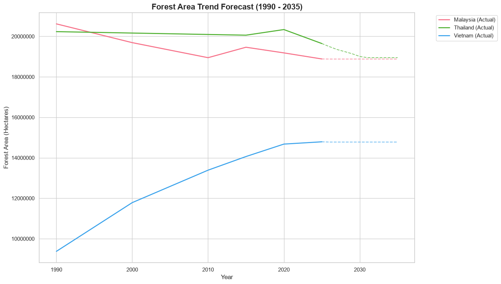
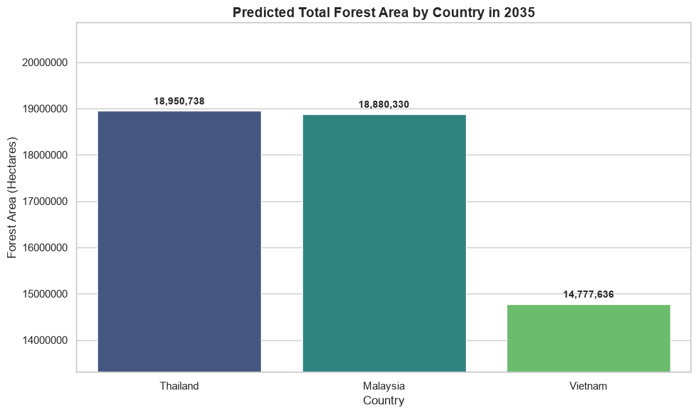

# การพยากรณ์พื้นที่ป่าไม้ด้วย XGBoost (มาเลเซีย ไทย เวียดนาม)

[English](README.md) | **ภาษาไทย**

โปรเจกต์นี้ใช้ **โมเดล XGBoost แบบ Regression** เพื่อศึกษาพื้นที่ป่าไม้ของ 3 ประเทศในเอเชียตะวันออกเฉียงใต้ ตั้งแต่ปี **1990 ถึง 2025** และ**พยากรณ์พื้นที่ป่าไม้ไปจนถึงปี 2035**

สิ่งที่ notebook ทำ:
1. สรุปสถิติพื้นที่ป่าไม้ของแต่ละประเทศ
2. วัดว่าแต่ละประเทศมีพื้นที่ป่าเพิ่มขึ้นหรือลดลงเท่าไรระหว่างปี 1990–2025
3. เทรนโมเดล XGBoost โดยใช้พื้นที่ป่าของปีก่อนหน้าเป็นตัวแปรหลัก
4. วัดความแม่นยำของโมเดล (MAE, RMSE, R², Accuracy %)
5. พยากรณ์พื้นที่ป่าปี 2026–2035 และบันทึกผลเป็นไฟล์ CSV
6. วาดกราฟเส้นแสดงแนวโน้ม และกราฟแท่งเปรียบเทียบปี 2035

---

## ไฟล์ในโปรเจกต์

| ไฟล์ | ประเภท | คำอธิบาย |
|---|---|---|
| `forest-area-3.xlsx` | **ข้อมูลนำเข้า** | ข้อมูลพื้นที่ป่าไม้ของมาเลเซีย ไทย และเวียดนาม ปี 1990–2025 (108 แถว) คอลัมน์: `Entity`, `Code`, `Year`, `Forest area` (หน่วย: เฮกตาร์) |
| `XGboot_forestArea.ipynb` | **โค้ด** | Jupyter notebook ที่ใช้วิเคราะห์ข้อมูล เทรนโมเดล และพยากรณ์ |
| `country_accuracy_with_total_area.csv` | **ผลลัพธ์** | ความแม่นยำของโมเดลแยกตามประเทศ สร้างโดย Cell 4 |
| `forest_forecast_hectares_2035.csv` | **ผลลัพธ์** | ข้อมูลจริง (1990–2025) รวมกับค่าพยากรณ์ (2026–2035) สร้างโดย Cell 5 |
| `images/` | **ผลลัพธ์** | รูปกราฟ 2 รูปที่ใช้แสดงใน README นี้ |

```
forest-area-3.xlsx ──► XGboot_forestArea.ipynb ──► country_accuracy_with_total_area.csv
   (ข้อมูลนำเข้า)        (วิเคราะห์ + โมเดล)         forest_forecast_hectares_2035.csv
```

ไฟล์ CSV ทั้งสองไฟล์จะถูก**สร้างใหม่ทุกครั้งที่รัน notebook** จึงลบได้โดยไม่มีผลเสีย ไฟล์ที่จำเป็นต้องมีจริงๆ มีแค่ `forest-area-3.xlsx` และ `XGboot_forestArea.ipynb`

---

## สิ่งที่ต้องมี

- **Python 3.10 ขึ้นไป** (ทดสอบแล้วบน Python 3.15)
- **Jupyter** ใช้ได้ทั้ง VS Code (ติดตั้ง Jupyter extension), JupyterLab หรือ Google Colab

### ไลบรารี

| ไลบรารี | ใช้ทำอะไร |
|---|---|
| `pandas` | โหลดและจัดการข้อมูล |
| `numpy` | คำนวณตัวเลข |
| `openpyxl` | ทำให้ pandas อ่านไฟล์ `.xlsx` ได้ |
| `xgboost` | โมเดล XGBoost แบบ Regression |
| `scikit-learn` | `LabelEncoder`, `MinMaxScaler`, `train_test_split` และค่าวัดความแม่นยำ |
| `matplotlib` | วาดกราฟ |
| `seaborn` | ตกแต่งกราฟและวาดกราฟแท่ง |
| `ipykernel` | ใช้รัน notebook ใน VS Code |

### วิธีติดตั้ง

```bash
pip install pandas numpy openpyxl xgboost scikit-learn matplotlib seaborn ipykernel
```

> **หมายเหตุสำหรับ Windows:** ถ้า `import pandas` แล้วเจอข้อความ
> `DLL load failed ... An Application Control policy has blocked this file`
> แปลว่า **Smart App Control** ของ Windows บล็อก pandas เวอร์ชันใหม่ล่าสุดอยู่ ให้ติดตั้งเวอร์ชันที่ Windows ยอมให้ใช้แทน:
> ```bash
> pip install pandas==3.0.6
> ```
> โปรเจกต์นี้ทดสอบกับ pandas 3.0.6, numpy 2.5.4, xgboost 3.4.1, scikit-learn 1.9.1, matplotlib 3.11.2 และ seaborn 0.13.2

---

## วิธีรัน

1. วางไฟล์ `forest-area-3.xlsx` ไว้ใน**โฟลเดอร์เดียวกัน**กับ `XGboot_forestArea.ipynb`
2. ติดตั้งไลบรารีตามหัวข้อด้านบน
3. เปิด `XGboot_forestArea.ipynb` ใน VS Code
4. เลือก Python kernel ที่ติดตั้งไลบรารีไว้ (มุมขวาบนของ notebook หรือในเมนู `...`)
5. กด **Run All**
6. เมื่อรันเสร็จ ไฟล์ CSV ทั้งสองไฟล์จะปรากฏในโฟลเดอร์ และกราฟจะแสดงใต้ Cell 6 และ Cell 7

> ถ้าติดตั้งหรือเปลี่ยนไลบรารีระหว่างที่เปิด notebook อยู่ ให้รีสตาร์ท kernel ก่อน (`...` → **Restart** หรือกด `Ctrl+Shift+P` → **Jupyter: Restart Kernel**)

**Google Colab:** อัปโหลดทั้งไฟล์ notebook และ `forest-area-3.xlsx` เข้าไปใน Colab แล้วเลือก **Runtime → Run all** ใน Colab มีไลบรารีทั้งหมดติดตั้งไว้ให้แล้ว

---

## โค้ดทำงานอย่างไร

### Cell 1 – โหลดข้อมูลและสรุปสถิติพื้นฐาน
- อ่านไฟล์ `forest-area-3.xlsx` (ถ้าไม่มีไฟล์ Excel จะลองอ่านไฟล์ CSV สำรองแทน)
- เรียงข้อมูลตามประเทศและปี เพื่อให้ขั้นตอนถัดไปทำงานถูกต้อง
- แสดง**ค่าเฉลี่ย ค่าต่ำสุด ค่าสูงสุด และส่วนเบี่ยงเบนมาตรฐาน**ของพื้นที่ป่าแต่ละประเทศ

### Cell 2 – แนวโน้มและ % การเปลี่ยนแปลง
เปรียบเทียบปี 1990 กับปี 2025 ของแต่ละประเทศ:
- **% การเปลี่ยนแปลง** = (2025 − 1990) / 1990 × 100
- **การเปลี่ยนแปลงเฉลี่ยต่อปี** = (2025 − 1990) / 35 ปี

### Cell 3 – สร้าง Feature และปรับสเกลข้อมูล
- สร้าง **Lag Feature** ชื่อ `Prev_Year_Area` คือพื้นที่ป่าของปีก่อนหน้า เป็นข้อมูลที่ช่วยโมเดลได้มากที่สุด เพราะพื้นที่ป่าเปลี่ยนแปลงทีละน้อยในแต่ละปี
- แปลงชื่อประเทศเป็นตัวเลขด้วย `LabelEncoder` (`Entity_ID`)
- ปรับสเกลข้อมูลทั้งหมดให้อยู่ในช่วง 0–1 ด้วย `MinMaxScaler`
- **ตัวแปรต้น (X):** `Entity_ID`, `Year`, `Prev_Year_Area`
- **ตัวแปรตาม (y):** `Forest area`

### Cell 4 – เทรนโมเดลและวัดความแม่นยำ
- แบ่งข้อมูลเป็น **Training 80% และ Test 20%** (`random_state=42`)
- เทรน `XGBRegressor` ด้วยค่า `n_estimators=2000`, `learning_rate=0.05`, `max_depth=6`, `subsample=0.7`
- คำนวณค่าวัดผลจากค่าจริง (ก่อนปรับสเกล):
  - **MAE** – ค่าความคลาดเคลื่อนสัมบูรณ์เฉลี่ย
  - **RMSE** – รากที่สองของค่าความคลาดเคลื่อนกำลังสองเฉลี่ย (ลงโทษความผิดพลาดที่ใหญ่มากกว่า)
  - **R²** – สัดส่วนที่โมเดลอธิบายความผันแปรของข้อมูลได้ (1.0 = สมบูรณ์แบบ)
  - **Accuracy (%)** = 100 − MAPE (ค่าความคลาดเคลื่อนเฉลี่ยเป็นเปอร์เซ็นต์)
- บันทึกตารางความแม่นยำรายประเทศลงไฟล์ `country_accuracy_with_total_area.csv`

### Cell 5 – พยากรณ์ปี 2026–2035
- เริ่มจากค่าจริงปี 2025 ของแต่ละประเทศ
- พยากรณ์ทีละปี แล้วใช้ค่าที่พยากรณ์ได้เป็น `Prev_Year_Area` ของปีถัดไป (**การพยากรณ์แบบ Recursive**)
- รวมข้อมูลจริงกับค่าพยากรณ์ แล้วบันทึกเป็น `forest_forecast_hectares_2035.csv` โดยคอลัมน์ `Data_Type` บอกว่าแถวนั้นเป็น `Actual` (ข้อมูลจริง) หรือ `Forecast` (ค่าพยากรณ์)

### Cell 6 – กราฟเส้นแสดงแนวโน้ม (1990–2035)
เส้นทึบคือข้อมูลจริง เส้นประคือค่าพยากรณ์

### Cell 7 – กราฟแท่งปี 2035
เปรียบเทียบพื้นที่ป่าที่พยากรณ์ได้ของแต่ละประเทศในปี 2035

---

## ผลลัพธ์

### 1. สถิติพื้นที่ป่าไม้ (1990–2025, หน่วย: เฮกตาร์)

| ประเทศ | ค่าเฉลี่ย | ค่าต่ำสุด | ค่าสูงสุด | ส่วนเบี่ยงเบนมาตรฐาน |
|---|---:|---:|---:|---:|
| มาเลเซีย | 19,508,934 | 18,884,740 | 20,618,500 | 492,581 |
| ไทย | 20,127,368 | 19,647,480 | 20,337,560 | 126,543 |
| เวียดนาม | 12,719,024 | 9,375,960 | 14,790,080 | 1,691,432 |

### 2. การเปลี่ยนแปลงระหว่างปี 1990 ถึง 2025

| ประเทศ | % การเปลี่ยนแปลง | การเปลี่ยนแปลงเฉลี่ยต่อปี (เฮกตาร์/ปี) |
|---|---:|---:|
| มาเลเซีย | **−8.41%** | −49,536 |
| ไทย | **−2.90%** | −16,786 |
| เวียดนาม | **+57.74%** | +154,689 |

มาเลเซียและไทยมีพื้นที่ป่าลดลง ขณะที่เวียดนามมีพื้นที่ป่าเพิ่มขึ้นมากกว่าครึ่ง

### 3. ประสิทธิภาพของโมเดล

| ชุดข้อมูล | MAE | RMSE | R² | Accuracy |
|---|---:|---:|---:|---:|
| Training set (ข้อมูลที่ใช้สอน) | 4,774 | 6,536 | 1.0000 | 99.97% |
| Test set (ข้อมูลที่ใช้ทดสอบ) | 73,460 | 100,230 | 0.9989 | 99.52% |

### 4. ความแม่นยำรายประเทศ (ทุกปี)

| ประเทศ | พื้นที่ป่ารวม (ผลรวมทุกปี, เฮกตาร์) | MAE | RMSE | Accuracy |
|---|---:|---:|---:|---:|
| มาเลเซีย | 681,703,140 | 19,598 | 41,450 | 99.90% |
| ไทย | 704,350,240 | 9,674 | 27,111 | 99.95% |
| เวียดนาม | 448,508,910 | 26,262 | 60,639 | 99.79% |

### 5. ค่าพยากรณ์ปี 2035

| ประเทศ | ค่าจริงปี 2025 (เฮกตาร์) | ค่าพยากรณ์ปี 2035 (เฮกตาร์) |
|---|---:|---:|
| ไทย | 19,647,480 | 18,950,738 |
| มาเลเซีย | 18,884,740 | 18,880,330 |
| เวียดนาม | 14,790,080 | 14,777,636 |

### กราฟ

**แนวโน้มพื้นที่ป่าไม้ ปี 1990–2035** (เส้นทึบ = ข้อมูลจริง, เส้นประ = ค่าพยากรณ์)



**พื้นที่ป่าไม้ที่พยากรณ์ได้ในปี 2035**



---

## ข้อจำกัด

- **ค่าพยากรณ์ค่อนข้างคงที่** XGBoost เป็นโมเดลแบบต้นไม้ (tree-based) จึงพยากรณ์ค่าที่อยู่นอกช่วงข้อมูลที่เคยเห็นตอนเทรนไม่ได้ เส้นพยากรณ์ของมาเลเซียและเวียดนามจึงแทบไม่เปลี่ยน และค่าของเวียดนามปี 2035 ไม่เพิ่มขึ้นตามแนวโน้มเดิม วิธีปรับปรุงที่นิยมคือให้โมเดลพยากรณ์**การเปลี่ยนแปลงรายปี**แทนการพยากรณ์พื้นที่ป่าโดยตรง
- **แบ่งข้อมูล Train/Test แบบสุ่ม** การแบ่ง 80/20 แบบสุ่มทำให้โมเดลถูกทดสอบกับปีที่อยู่ระหว่างปีที่ใช้เทรน ค่าความแม่นยำของ Test set จึงดูสูงกว่าการพยากรณ์ปีในอนาคตจริง การแบ่งตามเวลา (เช่น เทรนด้วยปี 1990–2018 แล้วทดสอบกับปี 2019–2025) จะเป็นการทดสอบที่ยุติธรรมกว่า
- **ข้อมูลมีจำนวนน้อย** มีเพียง 36 ปี × 3 ประเทศ = 108 แถว (เหลือ 105 แถวหลังสร้าง Lag Feature)
- **หน่วยในหัวตาราง** ข้อมูลมีหน่วยเป็น**เฮกตาร์** แต่หัวคอลัมน์ใน Cell 2 เขียนว่า `sq.km/yr` ตัวเลขที่ถูกต้องคือเฮกตาร์ต่อปี
